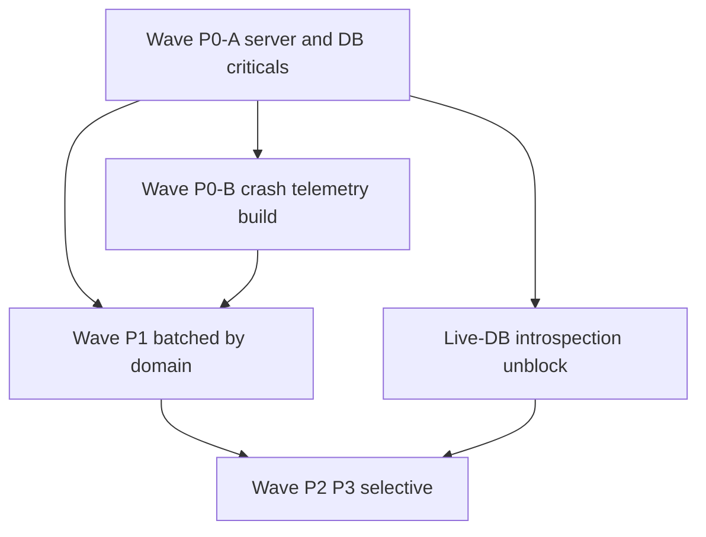

# Growlanzo — Consolidated Master Fix Plan

**Generated:** 2026-09-11
**Sources (4 forensic audit reports):**

- [`docs/AUDIT_FINDINGS_BACKEND_SECURITY.md`](docs/AUDIT_FINDINGS_BACKEND_SECURITY.md:1) — `SEC-*`, `API-*`, `AI-*`, `STORE-*`
- [`docs/AUDIT_FINDINGS_DATABASE.md`](docs/AUDIT_FINDINGS_DATABASE.md:1) — `DB-*`, `RLS-*`, `STORAGE-*`, `MONEY-*`
- [`docs/AUDIT_FINDINGS_FRONTEND.md`](docs/AUDIT_FINDINGS_FRONTEND.md:1) — `FE-*`, `UI-*`, `A11Y-*`, `PERF-*`, `SEO-*`, `FE-SEC-*`
- [`docs/AUDIT_FINDINGS_DEPS_LOGIC_OPS.md`](docs/AUDIT_FINDINGS_DEPS_LOGIC_OPS.md:1) — `DEP-*`, `LOGIC-*`, `EDGE-*`, `OBS-*`, `ERR-*`

**Constraint honored:** No source code was modified. The only file written is this document.

---

## 0. Coverage Check — Raw IDs vs Unique Masters

The four source documents advertise a **CLAIMED** combined total of **126** findings in their headers. The **actually enumerated** IDs in the bodies of the four documents total **147**. The discrepancy is a *documentation bug in the source reports* (header totals do not match enumerated tables), not a lost finding. This register enumerates from the **bodies**, not the headers.

| Doc | Header (claimed) | Enumerated (actual) | Delta | Note |
|---|---|---|---|---|
| BACKEND_SECURITY | 29 (P0 1 / P1 7 / P2 15 / P3 6) | 29 | 0 | Total matches; **P1/P2 split differs** (actual 6 / 16) |
| DATABASE | 27 (P0 3 / P1 9 / P2 11 / P3 4) | **42** | +15 | Body lists DB/RLS/STORAGE/MONEY = 6+14+10+12 |
| FRONTEND | 41 (P0 0 / P1 6 / P2 21 / P3 14) | **47** | +6 | Actual P1 = 12 (incl. FE-SEC-001), not 6 |
| DEPS_LOGIC_OPS | 29 (P0 3 / P1 9 / P2 15 / P3 2) | 29 | 0 | Consistent |
| **TOTAL** | **126** | **147** | **+21** | |

**Consolidation math:**

- Raw enumerated IDs: **147**
- Merge collapses (list in §2): **6**
- **Unique raw-ID masters: 141**
- Non-ID build defect (Vike SSR Windows path): **+1**
- **Total tracked items: 142**

**Severity roll-up (final, after merges + the user-mandated P0 promotion of `get_wallet_balance` IDOR):**

| Severity | Raw (enumerated) | Final masters |
|---|---|---|
| P0 | 7 | **8** (+1 non-ID build) |
| P1 | 40 | **38** |
| P2 | 73 | **68** |
| P3 | 27 | **27** |
| **Total** | **147** | **141 masters + 1 build = 142** |

> **Severity promotion note:** `RLS-002` (`get_wallet_balance` IDOR) is listed **P1** in the Database report, but the user's **Wave P0-A** explicitly names the "`get_wallet_balance` IDOR", so it is promoted to **P0 master `MR-05`** (merged with Backend Confirmed-Safe #19, [`src/lib/supabase.ts:358`](src/lib/supabase.ts:358)).

> **Cross-doc inconsistency (flag):** the Architecture Map reports **59** `ENABLE ROW LEVEL SECURITY` statements while Database §8 reports **69** (vs ~110 `CREATE TABLE`). The true figure must be resolved by live-DB introspection (see §7 Live-DB item 5).

---

## 1. Master Register

Ordered by **severity, then fix-order**. `Status` = `Open` everywhere (this is a plan, not a worklog); `(NEEDS-DB)` marks items whose exact remediation cannot be finalized until live-DB introspection (§7) completes.

### P0 — Critical (8 masters + 1 non-ID build defect)

| MasterID | Original IDs | Severity | Domain | File(s):line | Root cause | Required fix (concrete) | Blast radius | Verification method | Status |
|---|---|---|---|---|---|---|---|---|---|
| MR-01 | SEC-001 | P0 | Backend | [`supabase/functions/paypal-webhook/index.ts:70`](supabase/functions/paypal-webhook/index.ts:70), `:72` | `getCorsHeaders(origin)` is invoked but never imported/defined (only `serve` + `createClient` at :5-6); the call sits OUTSIDE the `try{` at :78 | Import `getCorsHeaders` from `_shared/cors.ts` (or remove the call) and move it inside the guarded block so CORS setup cannot throw | Every PayPal webhook request throws an uncaught ReferenceError → HTTP 500; all PayPal settlement/refund events dropped | POST a benign unsigned payload → must NOT return 500; function log has no ReferenceError | Open |
| MR-02 | RLS-001 | P0 | DB / RLS | [`supabase/migrations/20260801000000_admin_credentials.sql:20`](supabase/migrations/20260801000000_admin_credentials.sql:20) (-24); realtime :27; `20260904000000_admin_auth_rebuild.sql:95-97` | `admin_credentials` RLS policy omits the `TO` clause → defaults to `PUBLIC`, granting anon read/write of bcrypt password hashes; also added to the realtime publication | Recreate the policy as `TO authenticated` with an explicit admin-role predicate; remove `admin_credentials` from the `supabase_realtime` publication; delete the DEPRECATED-only comment path | Complete admin credential compromise; live hash exfiltration by any anon client | `SELECT policyname, roles, cmd, qual FROM pg_policies WHERE tablename='admin_credentials';` and anon `SELECT * FROM admin_credentials;` returns 0 rows/permission denied | Open (NEEDS-DB) |
| MR-03 | MONEY-001 | P0 | DB / Money | [`supabase/migrations/20261209000001_admin_decide_dispute.sql:44`](supabase/migrations/20261209000001_admin_decide_dispute.sql:44) (-68 client_refund), `:88-121` (split) | Dispute-resolution split path silently drops the wallet-funded credit | Recompute the ledger identity `freelancer_credit + platform_revenue == client_total_charged` in BOTH the client_refund branch and the split branch before commit | Silent money loss / unbalanced ledger on every wallet-funded dispute split | Reconciliation query nets to zero across both branches; dispute-split integration test | Open (NEEDS-DB) |
| MR-04 | MONEY-002 | P0 | DB / Money | [`supabase/migrations/20260920000000_*.sql:144`](supabase/migrations/20260920000000_comprehensive_backend_fixes.sql:144) (-183, esp. :176-179) | `admin_reverse_escrow` was re-created after `20260818000000` (the double-credit fix), reverting correct credit logic | Restore the corrected credit logic; make the latest definition authoritative and add a guard test | Double credit / money loss on escrow reversal | Reversal test balanced; ledger identity holds | Open (NEEDS-DB) |
| MR-05 | RLS-002, Backend-Confirmed-Safe #19 | P0 | DB / RLS + Frontend | [`supabase/migrations/20270101000020_*.sql:6`](supabase/migrations/20270101000020_*.sql:6) (-32); [`src/lib/supabase.ts:358`](src/lib/supabase.ts:358) | `get_wallet_balance` (SECURITY DEFINER) and the `dbFunctions` wallet helper trust a **client-supplied `userId`** → IDOR | Derive identity from `auth.uid()` inside the function; ignore/reject any client-passed `userId`; update the frontend helper to stop sending it | Cross-user wallet/financial data exposure | Authenticated call with a forged `userId` returns only the caller's data | Open (NEEDS-DB) |
| MR-06 | LOGIC-02 | P0 | Frontend | [`src/lib/authService.ts:366`](src/lib/authService.ts:366) | Browser calls `supabase.auth.admin.deleteUser`, which requires the service-role key | Move account deletion to an Edge Function / server endpoint that performs the admin call server-side | Account deletion broken in production; pressure to embed a privileged key in the client | Deletion succeeds with NO admin key present in the browser bundle | Open |
| MR-07 | OBS-03 | P0 | Frontend | [`src/lib/telemetry.ts:56`](src/lib/telemetry.ts:56) (insert), `:31` (schema) | Discards `message` and writes `event_id = null` into a `NOT NULL UNIQUE` column → every insert fails | Populate `message`; generate a unique `event_id` (uuid) per event | Telemetry never persists; `client_errors` table empty; blind to production faults | A forced client error yields an inserted row | Open |
| MR-08 | OBS-01 | P0 | Frontend | [`pages/+client.ts:7`](pages/+client.ts:7) | Sentry initializes only when `VITE_SENTRY_DSN` starts with `https://` (else silently skips) | Normalize/validate the DSN; initialize reliably and fail loud when misconfigured | Zero production error monitoring | Sentry receives a synthetic test event | Open |
| MR-09 | (no ID) BUILD | P0 | Build / Ops | [`scripts/build.mjs`](scripts/build.mjs:1); `@brillout/vite-plugin-server-entry` (`autoImporter.js:4`, `importServerProductionEntry.js:25`) | Vike SSR resolves a Windows path as `C:\c:\Users\...` → `ERR_MODULE_NOT_FOUND` | **Third-party/platform defect, NOT in-repo logic.** Mitigate by pinning/upgrading Vike or building under a POSIX path (CI is Linux; locally use WSL). Do not patch the vendored plugin | `npm run build` fails → no production artifact can be produced | `npm run build` succeeds on CI (Linux) | Open (platform) |

### P1 — High (38 masters)

| MasterID | Original IDs | Severity | Domain | File(s):line | Root cause | Required fix (concrete) | Blast radius | Verification method | Status |
|---|---|---|---|---|---|---|---|---|---|
| MR-10 | API-001 | P1 | Backend | [`supabase/functions/ai-matching/index.ts:465`](supabase/functions/ai-matching/index.ts:465), `:280` | Cross-tenant destructive writes; rate limiter keyed by `project_id` | Scope every mutation to the authenticated owner; key the rate limiter per authenticated user | Cross-tenant data destruction | Cross-org request rejected | Open |
| MR-11 | SEC-002 | P1 | Backend | [`supabase/functions/subscription-billing-cron/index.ts:57`](supabase/functions/subscription-billing-cron/index.ts:57), `:155` | No idempotency on billing run → duplicate charges on retry | Idempotency key + unique constraint per (subscription, period) | Double billing of customers | Two runs in one period create one invoice | Open |
| MR-12 | SEC-003 | P1 | Backend | [`supabase/functions/admin-data/index.ts:255`](supabase/functions/admin-data/index.ts:255) (-384; auth gate at :509) | `verify_certificate` / `verify_credential_qr` return PII **before** the auth gate | Move the authentication/authorization gate ahead of all queries | PII exposure to unauthenticated callers | Unauthenticated call → 401/403 | Open |
| MR-13 | SEC-004 | P1 | Backend | [`supabase/functions/kyc-submit/index.ts:249`](supabase/functions/kyc-submit/index.ts:249), `:261` | `devModeAdapter` auto-verifies KYC | Gate the dev adapter strictly to non-production | False KYC approval in prod if flag leaks | Production rejects the dev adapter path | Open (NEEDS-DB) |
| MR-14 | API-002 | P1 | Backend | [`supabase/functions/internship-applications/index.ts:1083`](supabase/functions/internship-applications/index.ts:1083) (-1113) | Anonymous tamper of applications keyed only by email | Require authentication + ownership check | Application data tampering | Anonymous tamper rejected | Open |
| MR-15 | AI-001 | P1 | Backend | [`supabase/functions/verify-document/index.ts:221`](supabase/functions/verify-document/index.ts:221) (-261) | Prompt injection in the AI document-verification prompt | Sanitize/escape user content; structure the prompt; constrain output schema | Manipulated verification outcome | Injection test cannot alter verdict | Open |
| MR-16 | SEC-013, STORAGE-003, API-007 (SSRF part) | P1 | Backend / Storage | [`supabase/functions/_shared/brevo.ts:70`](supabase/functions/_shared/brevo.ts:70) (-72); [`src/lib/avatarPack.ts:41`](src/lib/avatarPack.ts:41) (-91); [`supabase/functions/internship-applications/index.ts:73`](supabase/functions/internship-applications/index.ts:73) (-93) | Server-side fetch of a user-controlled URL (email attachment, avatar pack, internship attachment) → SSRF | Allowlist outbound hosts; block private/link-local ranges; validate URL scheme | Internal network / metadata access, file exfiltration | SSRF payload to 169.254/link-local refused | Open |
| MR-17 | SEC-010, ERR-04, AI-001 (leak), API-007 (leak) | P1 | Backend / Frontend | [`supabase/functions/withdrawal/index.ts:490`](supabase/functions/withdrawal/index.ts:490), [`razorpay/index.ts:1292`](supabase/functions/razorpay/index.ts:1292), [`subscription-billing-cron/index.ts:401`](supabase/functions/subscription-billing-cron/index.ts:401), [`twofa-management/index.ts:396`](supabase/functions/twofa-management/index.ts:396), [`admin-signup/index.ts:159`](supabase/functions/admin-signup/index.ts:159), `:184`, [`admin-withdrawal/index.ts:279`](supabase/functions/admin-withdrawal/index.ts:279), `:312`, [`process-deletion/index.ts:245`](supabase/functions/process-deletion/index.ts:245), [`delete-account/index.ts:160`](supabase/functions/delete-account/index.ts:160), [`proposal-notifications/index.ts:262`](supabase/functions/proposal-notifications/index.ts:262), `:360`, [`newsletter-subscribe/index.ts:322`](supabase/functions/newsletter-subscribe/index.ts:322), [`notifications/index.ts:398`](supabase/functions/notifications/index.ts:398), [`notification-preferences/index.ts:228`](supabase/functions/notification-preferences/index.ts:228), [`ai-assistant/index.ts:528`](supabase/functions/ai-assistant/index.ts:528), [`ai-matching/index.ts:384`](supabase/functions/ai-matching/index.ts:384), `:494`, [`ai-ticket-responder/index.ts:368`](supabase/functions/ai-ticket-responder/index.ts:368), [`avatar-upload/index.ts:232`](supabase/functions/avatar-upload/index.ts:232), [`file-upload/index.ts:377`](supabase/functions/file-upload/index.ts:377), [`verify-document/index.ts:349`](supabase/functions/verify-document/index.ts:349), [`internship-applications/index.ts:1149`](supabase/functions/internship-applications/index.ts:1149) | Pervasive raw `error.message` returned to clients (info disclosure) | Return generic client messages; log full detail server-side only | Schema/stack/internal detail disclosure | No `error.message` reaches HTTP responses | Open |
| MR-18 | MONEY-003 | P1 | DB / Money | money-function family (DB §9 list) | Systemic regression: later `CREATE OR REPLACE` migrations override earlier money fixes | Reapply authoritative definitions in a single ordered migration + regression test | Money loss across several RPCs | Reconciliation + unit tests green | Open (NEEDS-DB) |
| MR-19 | MONEY-004 | P1 | DB / Money | [`supabase/migrations/20270117000000_*.sql:1`](supabase/migrations/20270117000000_*.sql:1) (-101) | Comma-quoted `SET search_path` breaks `cancel_withdrawal`, `release_milestone`, `process_withdrawal_complete` | Correct quoting (comma-separated list without stray quotes) | Withdrawal & milestone flows fail | Functions execute successfully under call | Open (NEEDS-DB) |
| MR-20 | MONEY-005 | P1 | DB / Money | [`supabase/migrations/20260610110000_escrow_rpcs.sql:148`](supabase/migrations/20260610110000_escrow_rpcs.sql:148) (-232) | `release_escrow` delegates to an end-user auth-checked RPC → fails when called by cron | Delegate to an internal helper without end-user auth checks | Escrow auto-release fails via cron | Cron-triggered release succeeds | Open (NEEDS-DB) |
| MR-21 | RLS-003, MONEY-006 | P1 | DB / Money | [`supabase/migrations/20261220000000_*.sql:198`](supabase/migrations/20261220000000_escrow_release_fixes.sql:198) (-290; RLS-003 :241-253) | `release_escrow` computes from a **fee-inclusive** pool (same artifact reported by both docs) | Use the fee-exclusive base for the pool calculation | Fee misallocation / freelancer underpay | Ledger identity holds on release | Open (NEEDS-DB) |
| MR-22 | RLS-005 | P1 | DB / RLS | [`supabase/migrations/20260920000000_*.sql:144`](supabase/migrations/20260920000000_comprehensive_backend_fixes.sql:144) vs [`20260818000000_*.sql:37`](supabase/migrations/20260818000000_fix_refund_wallet_double_credit.sql:37) (-107) | Migration-order regression: re-created function reverts prior fix (**same artifact as MONEY-002/MR-04**) | Handled by the MR-04 workstream; retained as a separate register row per instruction | (see MR-04) | (see MR-04) | Open (NEEDS-DB) |
| MR-23 | RLS-004 | P1 | DB / RLS | many `SECURITY DEFINER` functions (DB §9, ~24 refs) | Functions omit `SET search_path` | Add `SET search_path = public, pg_temp` (or fully-qualified identifiers) to every definer | `search_path` injection / privilege escalation | Every definer lists `search_path` | Open (NEEDS-DB) |
| MR-24 | RLS-006 | P1 | DB / RLS | [`supabase/migrations/20260629000000_*.sql:144`](supabase/migrations/20260629000000_marketplace_features.sql:144) (-145) | Contest SECURITY DEFINER misconfigured | Correct the definer configuration | Contest data exposure | Policy/definer check passes | Open (NEEDS-DB) |
| MR-25 | DB-001 | P1 | DB | `20260920000000`, `20260923000000`, `20260814000000`, `20260818000000` | Schema drift; 4 repair migrations diverge from baseline | Consolidate drift into an ordered baseline; add drift check | Unpredictable schema across environments | Schema diff shows no drift | Open |
| MR-26 | STORAGE-001 | P1 | Frontend / Storage | [`src/lib/avatarUpload.ts:78`](src/lib/avatarUpload.ts:78) (-103); [`src/lib/avatarPack.ts:107`](src/lib/avatarPack.ts:107) (-201) | Browser client creates storage buckets | Move bucket creation to a migration/server path | Client can mutate storage config | Bucket exists only via migration | Open |
| MR-27 | STORAGE-002 | P1 | Frontend / Storage | [`src/lib/avatarPack.ts:107`](src/lib/avatarPack.ts:107) (-201) | Client-controlled `companyId` used in the storage path | Derive the path server-side from the session | Cross-tenant file write | Forged path rejected | Open |
| MR-28 | EDGE-01 | P1 | Frontend | [`src/context/AuthContext.tsx:1176`](src/context/AuthContext.tsx:1176), `:1049` | Double-submit on auth actions (no in-flight guard) | Disable/guard the action while in flight | Duplicate accounts / duplicate operations | Double-click yields a single operation | Open |
| MR-29 | EDGE-02 | P1 | Frontend | [`src/pages/OtpLoginPage.tsx:23`](src/pages/OtpLoginPage.tsx:23), `:71` | OTP attempt limit enforced client-side only | Enforce server-side rate limit | OTP brute force | Server blocks attempts beyond N | Open |
| MR-30 | EDGE-04 | P1 | Frontend | [`src/pages/AuthCallbackPage.tsx:125`](src/pages/AuthCallbackPage.tsx:125) | Fragile auth recovery ladder | Harden the fallback sequence | Broken login recovery | Recovery flow passes end-to-end | Open |
| MR-31 | LOGIC-01 | P1 | Frontend | [`src/lib/dataService.ts:686`](src/lib/dataService.ts:686), `:604` | Status-only release skips the ledger credit | Route release through the money RPC | Freelancer not paid | Wallet balance credited on release | Open |
| MR-32 | DEP-04 | P1 | Deps | [`package.json`](package.json:1) | 11 vulnerabilities (5 high / 6 moderate) | Upgrade affected transitive dependencies | Supply-chain risk | `npm audit` high/moderate reduced to 0 | Open |
| MR-33 | A11Y-001 | P1 | Frontend | [`src/components/ModalShell.tsx:44`](src/components/ModalShell.tsx:44) (-124) | Modal lacks `role="dialog"` / focus trap | Add `role`, `aria-modal`, and a focus trap | Keyboard/SR users cannot operate modals | axe-core pass; keyboard test | Open |
| MR-34 | A11Y-002 | P1 | Frontend | [`src/components/Toast.tsx:100`](src/components/Toast.tsx:100) (-188) | Toast lacks a live region | Add `role="status"` / `aria-live` | SR users miss notifications | axe-core pass | Open |
| MR-35 | A11Y-003 | P1 | Frontend | app shell (`src/app/`) | No skip-to-content link | Add a skip link | Keyboard navigation burden | axe-core pass | Open |
| MR-36 | A11Y-004 | P1 | Frontend | forms (multiple) | Form errors not linked via `aria-describedby` | Associate errors with inputs | SR users miss validation errors | axe-core pass | Open |
| MR-37 | FE-001 | P1 | Frontend | [`src/main.tsx:1`](src/main.tsx:1) (-10) vs [`src/app/App.tsx`](src/app/App.tsx:1) | `main.tsx` is a stub while the real app lives in `src/app/App.tsx` | Confirm the real entry point and remove the dead stub | Boot-path confusion / dead code | Entry resolves correctly | Open |
| MR-38 | FE-002 | P1 | Frontend | codebase-wide | 300+ casts under `strict: false` | Enable `strict` incrementally and remove casts | Type-safety debt / latent runtime bugs | `tsc --strict` passes | Open |
| MR-39 | FE-005, FE-SEC-001 | P1 | Frontend | [`src/pages/AuthCallbackPage.tsx:546`](src/pages/AuthCallbackPage.tsx:546) (-548) | Manual `localStorage` token persistence (same file:line reported as both an FE and a FE-SEC finding) | Let `supabase-js` manage the session; stop manual token writes | Token theft / XSS exfiltration | No manual token writes remain | Open |
| MR-40 | PERF-001 | P1 | Frontend | [`src/pages/PortfolioPage.tsx:66`](src/pages/PortfolioPage.tsx:66); [`src/pages/AdminDashboard.tsx:257`](src/pages/AdminDashboard.tsx:257), `:418` | Refetch loops because effects depend on the fetch function identity | Stabilize deps (`useCallback`/refs) | Excess DB load / infinite-ish loops | Request count drops measurably | Open |
| MR-41 | PERF-002 | P1 | Frontend | codebase-wide | Almost no `AbortController` on fetch | Abort in-flight requests on unmount | Wasted work / state races | No post-unmount state updates | Open |
| MR-42 | SEO-001 | P1 | Frontend | [`public/robots.txt:1`](public/robots.txt:1) (-4) | `robots.txt` allows `/admin` and `/dashboard` | Disallow private routes | Private pages indexed by search engines | robots.txt rules verified | Open |
| MR-43 | SEO-002 | P1 | Frontend | [`pages/+Head.tsx:3`](pages/+Head.tsx:3) (-120); [`index.html`](index.html:1) | No per-page metadata | Add per-route head metadata | Poor SEO / wrong previews | Unique head per route | Open |
| MR-44 | OBS-02 | P1 | Frontend | [`pages/+client.ts:26`](pages/+client.ts:26) | Swallowed catch block | Log/report properly | Silent failures | Error surfaces to Sentry | Open |
| MR-45 | OBS-05 | P1 | Frontend / Ops | [`src/pages/StatusPage.tsx:19`](src/pages/StatusPage.tsx:19) | Status page lacks edge/cron/webhook coverage | Extend monitors to those surfaces | Operational blind spots | Monitors cover edge/cron/webhook | Open |
| MR-46 | OBS-06 | P1 | Ops / Test | [`vitest.config.ts`](vitest.config.ts:1); [`package.json`](package.json:1) | Test toolchain red (threads pool collection error on Node 24) | Fix Vitest pool/config so `vitest run` is green | No reliable regression signal | `vitest run` passes | Open |
| MR-47 | ERR-01 | P1 | Frontend | [`src/lib/telemetry.ts:41`](src/lib/telemetry.ts:41), `:42` | Swallowed errors in the telemetry path | Propagate/report instead of discarding | Hidden failures | Error is captured | Open |

### P2 — Medium (68 masters)

| MasterID | Original IDs | Severity | Domain | File(s):line | Root cause | Required fix (concrete) | Blast radius | Verification method | Status |
|---|---|---|---|---|---|---|---|---|---|
| MR-48 | SEC-005 | P2 | Backend | [`razorpay/index.ts:18`](supabase/functions/razorpay/index.ts:18); [`subscription-billing-cron/index.ts:26`](supabase/functions/subscription-billing-cron/index.ts:26); [`milestone-auto-release/index.ts:31`](supabase/functions/milestone-auto-release/index.ts:31), `:32`, `:40`; [`security-alert-notify/index.ts:81`](supabase/functions/security-alert-notify/index.ts:81), `:89`; [`process-deletion/index.ts:27`](supabase/functions/process-deletion/index.ts:27) | Cron-secret compared with non-constant-time `===` in 5 functions (contrast the safe `safeEqual` in razorpay-webhook:28) | Use a constant-time compare (`safeEqual`) in all 5 functions | Timing-based secret recovery → unauthorized cron invocation | Timing-safe compare present in all 5 | Open |
| MR-49 | SEC-006, API-003 | P2 | Backend | [`kyc-submit/index.ts:82`](supabase/functions/kyc-submit/index.ts:82) (-86); [`verify-document/index.ts:137`](supabase/functions/verify-document/index.ts:137) (-142); 16 divergent local `getCorsHeaders` helpers | Hardcoded `*` CORS in two functions plus 16 local CORS helpers that fall back to `ALLOWED_ORIGINS[0]` | Route all through `_shared/cors.ts`; remove hardcoded `*` | Over-permissive / inconsistent CORS | All handlers import the shared CORS module | Open |
| MR-50 | SEC-007 | P2 | Backend | [`razorpay/index.ts:188`](supabase/functions/razorpay/index.ts:188) (-204) | `test_auth` returns `key_id_prefix` unauthenticated | Require auth before returning key data | Minor key-info disclosure | Unauthenticated call rejected | Open |
| MR-51 | SEC-008 | P2 | Backend | [`newsletter/index.ts:285`](supabase/functions/newsletter/index.ts:285) (-313) | Unsubscribe allowed by email only | Add a signed token / confirm step | Unauthorized unsubscription | Forged unsubscribe rejected | Open |
| MR-52 | API-004 | P2 | Backend | [`paypal/index.ts:541`](supabase/functions/paypal/index.ts:541) (-614) | `refund_order` does not validate `refundAmount` | Clamp/validate against the captured amount | Over-refund | Over-amount rejected | Open |
| MR-53 | API-005 | P2 | Backend | [`ai-matching/index.ts:280`](supabase/functions/ai-matching/index.ts:280) | Rate limit keyed by `project_id` | Key per authenticated user | Rate-limit evasion | Per-user limit enforced | Open |
| MR-54 | API-006 | P2 | Backend | [`email-notifications/index.ts:551`](supabase/functions/email-notifications/index.ts:551), `:565` (-568; comment :524) | Reads `profiles.email` after the column moved to `profiles_private` | Read from the current location | Broken notification emails | Emails resolve correctly | Open |
| MR-55 | SEC-009 | P2 | Backend / Config | [`.env.local:3`](.env.local:3) | Live service-role key present in a local env file | Rotate the key; ensure `.env.local` is git-ignored and never committed | Full backend compromise if leaked | Key rotated; secret-scan clean | Open |
| MR-56 | SEC-011 | P2 | Backend | [`withdrawal/index.ts:210`](supabase/functions/withdrawal/index.ts:210) | Weak withdrawal amount validation | Validate against balance/limits server-side | Invalid/negative withdrawals | Bad inputs rejected | Open |
| MR-57 | SEC-012 | P2 | Backend | [`admin-data/index.ts:54`](supabase/functions/admin-data/index.ts:54); `:599-653`; `:656-730` | Fail-open rate limit; client-supplied `admin_id`; `Math.random()` QR/cert generation | Fail closed; derive admin identity from session; use CSPRNG | Admin impersonation / weak tokens | Forged admin_id rejected; CSPRNG used | Open |
| MR-58 | SEC-014 | P2 | Backend | [`paypal-webhook/index.ts:105`](supabase/functions/paypal-webhook/index.ts:105) (-172) | `CAPTURE.COMPLETED` handler lacks `event.id` idempotency | Deduplicate on `event.id` | Duplicate processing | Duplicate event handled once | Open |
| MR-59 | SEC-015 | P2 | Frontend | [`src/context/AuthContext.tsx:1216`](src/context/AuthContext.tsx:1216), `:126-136` | Client-trusted role | Source role from DB/JWT claims only | Privilege escalation | Forged local role ignored | Open (NEEDS-DB) |
| MR-60 | DB-002 | P2 | DB | `wallets` table | `DECIMAL(12,2)` with no CHECK; `currency DEFAULT 'USD'` | Add CHECK constraint; set `DEFAULT 'INR'` | Currency/precision corruption | Constraint enforces valid values | Open |
| MR-61 | DB-003 | P2 | DB | nine wallet RPCs | Wallet RPCs granted to `authenticated` broadly | Narrow grants to required roles | Unauthorized wallet ops | Grants reviewed | Open |
| MR-62 | DB-004 | P2 | DB | migrations | Non-idempotent `DROP INDEX` | Use `DROP INDEX IF EXISTS` | Migration failure on re-run | Migration re-runs cleanly | Open |
| MR-63 | DB-005 | P2 | DB | migrations | Compensating `ADD COLUMN IF NOT EXISTS` masks drift | Remove compensating stmts after baseline fix | Hidden drift | No compensating stmts needed | Open |
| MR-64 | RLS-007 | P2 | DB / RLS | migration | RLS policy gap (partly remediated) | Tighten policy | Data exposure | Policy check passes | Open |
| MR-65 | RLS-008 | P2 | DB / RLS | migration | RLS policy gap (partly remediated) | Tighten policy | Data exposure | Policy check passes | Open |
| MR-66 | RLS-009 | P2 | DB / RLS | migration | RLS policy gap (partly remediated) | Tighten policy | Data exposure | Policy check passes | Open |
| MR-67 | RLS-010 | P2 | DB / RLS | migration | RLS policy gap (partly remediated) | Tighten policy | Data exposure | Policy check passes | Open |
| MR-68 | RLS-011 | P2 | DB / RLS | migration | RLS policy gap (partly remediated) | Tighten policy | Data exposure | Policy check passes | Open |
| MR-69 | RLS-012 | P2 | DB / RLS | migration | RLS policy gap (partly remediated) | Tighten policy | Data exposure | Policy check passes | Open |
| MR-70 | RLS-013 | P2 | DB / RLS | migration | RLS policy gap (partly remediated) | Tighten policy | Data exposure | Policy check passes | Open |
| MR-71 | STORAGE-004 | P2 | Storage | [`src/lib/portfolioImageUpload.ts:59`](src/lib/portfolioImageUpload.ts:59) (-117) | SVG accepted for portfolio images (XSS vector) | Reject SVG or sanitize | Stored XSS via SVG | SVG upload rejected | Open |
| MR-72 | STORAGE-005 | P2 | Storage | contest submission uploads | Storage policy gap | Tighten bucket policy | File exposure | Policy check passes | Open |
| MR-73 | STORAGE-006 | P2 | Storage | internship buckets | Storage policy gap | Tighten bucket policy | File exposure | Policy check passes | Open |
| MR-74 | STORAGE-007 | P2 | Storage | verification-documents bucket | Storage policy gap | Tighten bucket policy | PII exposure | Policy check passes | Open |
| MR-75 | STORAGE-008 | P2 | Storage | contract-files bucket | Storage policy gap | Tighten bucket policy | Contract exposure | Policy check passes | Open |
| MR-76 | MONEY-007 | P2 | DB / Money | money functions | `EXCEPTION WHEN OTHERS THEN NULL` swallows money errors | Re-raise / log errors | Silent money failure | Errors surface | Open |
| MR-77 | MONEY-008 | P2 | DB / Money | payout-method RPCs | Authz/validation gaps | Add checks | Unauthorized payout changes | Checks enforced | Open |
| MR-78 | MONEY-009 | P2 | DB / Money | `admin_fund_escrow` | No inline admin check | Add inline admin check | Unauthorized funding | Non-admin rejected | Open |
| MR-79 | MONEY-010 | P2 | DB / Money | money functions | Currency inconsistency | Normalize to INR | Mixed-currency corruption | All money in INR | Open |
| MR-80 | MONEY-011 | P2 | DB / Money | tables | Missing indexes | Add indexes | Slow queries | Query plan improved | Open |
| MR-81 | A11Y-005 | P2 | Frontend | images (8/90 lazy) | Mostly non-lazy images | Add `loading="lazy"` | Perf/bandwidth | Lighthouse improves | Open |
| MR-82 | A11Y-006 | P2 | Frontend | [`src/components/IndustrySelect.tsx:70`](src/components/IndustrySelect.tsx:70) (-81) | `div` used as a button | Use a real `button` | Keyboard inoperable | axe-core pass | Open |
| MR-83 | FE-003 | P2 | Frontend | [`src/app/App.tsx:184`](src/app/App.tsx:184) (-215, :236-372) | Route drift | Reconcile route map | Unreachable/duplicate routes | Route audit clean | Open |
| MR-84 | FE-004 | P2 | Frontend | `DashboardLayout.tsx:368-506`, `:509-647` | ~900 lines sidebar duplication | Extract shared component | Maintenance burden | Single source | Open |
| MR-85 | FE-006 | P2 | Frontend | codebase | 261 `console.*` calls | Replace with logger/gate | Noise/perf | Console removed from prod | Open |
| MR-86 | FE-008 | P2 | Frontend | `WorkspacePage.tsx` | 7 effects with tangled deps | Refactor effects | Bugs/perf | Effects simplified | Open |
| MR-87 | FE-009 | P2 | Frontend | codebase | 99 index-based keys | Use stable keys | Render bugs | Keys stable | Open |
| MR-88 | FE-010 | P2 | Frontend | codebase | 5 competing auth mechanisms | Consolidate to one | Confusion/security gaps | One mechanism | Open |
| MR-89 | FE-012 | P2 | Frontend | app shell | Single `ErrorBoundary` | Add granular boundaries | Blast radius of errors | Boundaries scoped | Open |
| MR-90 | PERF-003 | P2 | Frontend | queries | Missing limit caps | Add limits | Heavy queries | Limits applied | Open |
| MR-91 | PERF-004 | P2 | Frontend | [`src/pages/HomePage.tsx:138`](src/pages/HomePage.tsx:138) (-150) | Hero video `preload="auto"` | Lazy/preload metadata | Slow LCP | LCP improves | Open |
| MR-92 | PERF-005 | P2 | Frontend | images | Unoptimized images | Use modern formats/sizes | Bandwidth | Lighthouse improves | Open |
| MR-93 | PERF-006 | P2 | Frontend | realtime badge | Realtime + polling duplicate | Remove one | Excess load | Single source | Open |
| MR-94 | PERF-007 | P2 | Frontend | components | No memoization | Add `memo`/`useMemo` | Re-render churn | Render count drops | Open |
| MR-95 | UI-001 | P2 | Frontend | decorative blur circles | Visual/perf noise | Simplify | Render cost | Visual QA | Open |
| MR-96 | UI-002 | P2 | Frontend | `ProSubscription` table `min-w-[560px]` | Horizontal overflow on mobile | Responsive table | Mobile UX | Responsive check | Open |
| MR-97 | UI-005 | P2 | Frontend | forms | Double-submit via keyboard | Guard submit | Duplicate ops | Keyboard test | Open |
| MR-98 | UI-008 | P2 | Frontend | pages | Thin error states | Improve error UI | Poor UX | QA | Open |
| MR-99 | SEO-003 | P2 | Frontend | [`public/sitemap.xml`](public/sitemap.xml:1) | Missing 3 routes | Add routes | Incomplete indexing | Sitemap complete | Open |
| MR-100 | SEO-004 | P2 | Frontend | [`public/manifest.json`](public/manifest.json:1) | Missing icons/shortcuts | Complete manifest | PWA gaps | Manifest valid | Open |
| MR-101 | SEO-005 | P2 | Frontend | boot overlay | No noscript fallback | Add `<noscript>` | No-JS users blocked | Noscript present | Open |
| MR-102 | DEP-01 | P2 | Deps | [`package.json`](package.json:1) | Dependency hygiene issue | Pin/upgrade | Supply chain | Audit review | Open |
| MR-103 | DEP-02 | P2 | Deps | [`package.json`](package.json:1) | Dependency hygiene issue | Pin/upgrade | Supply chain | Audit review | Open |
| MR-104 | DEP-03 | P2 | Deps | [`package.json`](package.json:1) | Dependency hygiene issue | Pin/upgrade | Supply chain | Audit review | Open |
| MR-105 | DEP-05 | P2 | Deps | [`package.json`](package.json:1) | `undici` shipped as unused prod dependency | Remove or justify | Bloat/attack surface | Dependency removed | Open |
| MR-106 | LOGIC-03 | P2 | Frontend | logic modules | Logic defect | Correct logic | Incorrect behavior | Unit test | Open |
| MR-107 | LOGIC-04 | P2 | Frontend | logic modules | Logic defect | Correct logic | Incorrect behavior | Unit test | Open |
| MR-108 | EDGE-03 | P2 | Frontend | edge flow | Edge-case gap | Handle case | Bad edge UX | Test | Open |
| MR-109 | EDGE-05 | P2 | Frontend | edge flow | Edge-case gap | Handle case | Bad edge UX | Test | Open |
| MR-110 | EDGE-06 | P2 | Frontend | edge flow | Edge-case gap | Handle case | Bad edge UX | Test | Open |
| MR-111 | EDGE-07 | P2 | Frontend | edge flow | Edge-case gap | Handle case | Bad edge UX | Test | Open |
| MR-112 | OBS-04 | P2 | Ops | observability | Monitoring gap | Add coverage | Blind spot | Monitor present | Open |
| MR-113 | OBS-07 | P2 | Ops | observability | Monitoring gap | Add coverage | Blind spot | Monitor present | Open |
| MR-114 | ERR-02 | P2 | Frontend | error handling | Error handling gap | Handle properly | Silent failure | Error surfaces | Open |
| MR-115 | ERR-03 | P2 | Frontend | error handling | Error handling gap | Handle properly | Silent failure | Error surfaces | Open |

### P3 — Low (27 masters)

| MasterID | Original IDs | Severity | Domain | File(s):line | Root cause | Required fix (concrete) | Blast radius | Verification method | Status |
|---|---|---|---|---|---|---|---|---|---|
| MR-116 | STORE-001 | P3 | Backend | [`file-upload/index.ts:71`](supabase/functions/file-upload/index.ts:71), `:157` | Limit mismatch (25MB vs "50MB" copy) | Align limit + copy | Confusing UX | Copy matches limit | Open |
| MR-117 | STORE-002 | P3 | Backend | [`avatar-upload/index.ts:150`](supabase/functions/avatar-upload/index.ts:150) (-151) | Extension derived from filename | Derive from MIME/magic bytes | Bad files accepted | Validation enforced | Open |
| MR-118 | STORE-003 | P3 | Frontend | `DebugPage.tsx:13-15` | Env exposure in debug page | Remove/gate | Info disclosure | Page removed/gated | Open |
| MR-119 | STORE-004 | P3 | Backend | [`internship-applications/index.ts:122`](supabase/functions/internship-applications/index.ts:122) | Attachment map issue | Fix mapping | Broken attachments | Attachments resolve | Open |
| MR-120 | STORE-005 | P3 | Backend | `Math.random()` filename | Weak filename randomness | Use CSPRNG | Collision/predictability | CSPRNG used | Open |
| MR-121 | STORE-006 | P3 | Backend | `:26`, `:46`, `:55` | In-memory rate limiters | Move to durable store | Evasion on restart | Durable limiter | Open |
| MR-122 | DB-006 | P3 | DB | `idx_wallets_user_id` | Redundant index | Drop it | Minor write overhead | Index dropped | Open |
| MR-123 | RLS-014 | P3 | DB / RLS | realtime | Realtime exposure | Restrict publication | Minor exposure | Publication tightened | Open |
| MR-124 | STORAGE-009 | P3 | Storage | videos bucket | Policy gap | Tighten | Minor exposure | Policy check | Open |
| MR-125 | STORAGE-010 | P3 | Storage | avatars/portfolio-public | Policy gap | Tighten | Minor exposure | Policy check | Open |
| MR-126 | MONEY-012 | P3 | DB / Money | stale-withdrawal cron | Stale withdrawals not cleaned | Add cron cleanup | Stuck records | Cron cleans | Open |
| MR-127 | A11Y-007 | P3 | Frontend | theme colors | Contrast issues | Adjust colors | Accessibility | axe-core pass | Open |
| MR-128 | FE-007 | P3 | Frontend | [`src/hooks/useAboutPageMetrics.ts:108`](src/hooks/useAboutPageMetrics.ts:108) | Single TODO | Resolve | Minor debt | TODO removed | Open |
| MR-129 | FE-011 | P3 | Frontend | `src/lib/` | Flat lib structure | Reorganize | Maintenance | Structure improved | Open |
| MR-130 | FE-013 | P3 | Frontend | dev-gating | Inconsistent dev gating | Centralize | Leakage risk | Gating centralized | Open |
| MR-131 | PERF-008 | P3 | Frontend | `cacheManager` | Weak cache strategy | Improve caching | Minor perf | Perf improves | Open |
| MR-132 | PERF-009 | P3 | Frontend | Suspense | Single Suspense boundary | Add granularity | Coarse loading UX | Boundaries scoped | Open |
| MR-133 | PERF-010 | P3 | Frontend | realtime | Per-component realtime subscriptions | Consolidate | Excess connections | Fewer subscriptions | Open |
| MR-134 | UI-003 | P3 | Frontend | modals | Modal width inconsistency | Standardize | Visual polish | Design QA | Open |
| MR-135 | UI-004 | P3 | Frontend | modals | Modal width inconsistency | Standardize | Visual polish | Design QA | Open |
| MR-136 | UI-006 | P3 | Frontend | overlays | Ad-hoc overlays | Use shared component | Visual polish | Design QA | Open |
| MR-137 | UI-007 | P3 | Frontend | Tailwind | Arbitrary values | Use tokens | Consistency | Design QA | Open |
| MR-138 | UI-009 | P3 | Frontend | focus styles | `focus-visible` gaps | Add styles | Accessibility polish | Keyboard QA | Open |
| MR-139 | FE-SEC-002 | P3 | Frontend | `VITE_*` allowlist | Allowlist present/clean (verify only) | Confirm no secrets | — | Verified clean | Open |
| MR-140 | FE-SEC-003 | P3 | Frontend | [`public/platform-metrics.json`](public/platform-metrics.json:1), opaque `.html` | Public artifact exposure | Remove/minimize | Minor disclosure | Artifacts reviewed | Open |
| MR-141 | DEP-06 | P3 | Deps | [`package.json`](package.json:1) | Minor dependency hygiene | Clean up | Minor | Audit review | Open |
| MR-142 | ERR-05 | P3 | Frontend | error handling | Minor error-handling gap | Handle properly | Minor UX | Test | Open |

---

## 2. Deduplication — Merge Mapping

Six merge collapses were applied. **Nothing is dropped**: every raw ID appears either as a standalone master or in the `Original IDs` column of a merged master.

| Merge | Into MasterID | Original IDs merged | Shared root cause |
|---|---|---|---|
| M-A | **MR-05** | `RLS-002` + Backend-Confirmed-Safe #19 | Client-supplied `userId` IDOR in `get_wallet_balance` / `dbFunctions` ([`src/lib/supabase.ts:358`](src/lib/supabase.ts:358)) |
| M-B | **MR-49** | `SEC-006` + `API-003` | CORS divergence: hardcoded `*` + 16 divergent local `getCorsHeaders` helpers |
| M-C | **MR-16** | `SEC-013` + `STORAGE-003` + `API-007` (SSRF component) | SSRF via user-controlled outbound URL |
| M-D | **MR-17** | `SEC-010` + `ERR-04` + `AI-001` (leak component, :349) + `API-007` (leak component, :1149) | Raw `error.message` leakage to clients |
| M-E | **MR-39** | `FE-005` + `FE-SEC-001` | Manual `localStorage` token persistence ([`AuthCallbackPage.tsx:546-548`](src/pages/AuthCallbackPage.tsx:546)) |
| M-F | **MR-21** | `RLS-003` + `MONEY-006` | `release_escrow` fee-inclusive pool (same migration artifact) |

**Non-constant-time cron secret (SEC-005 → single master MR-48):** consolidated single item listing all five functions:

1. [`razorpay/index.ts:18`](supabase/functions/razorpay/index.ts:18)
2. [`subscription-billing-cron/index.ts:26`](supabase/functions/subscription-billing-cron/index.ts:26)
3. [`milestone-auto-release/index.ts:31`](supabase/functions/milestone-auto-release/index.ts:31), `:32`, `:40`
4. [`security-alert-notify/index.ts:81`](supabase/functions/security-alert-notify/index.ts:81), `:89`
5. [`process-deletion/index.ts:27`](supabase/functions/process-deletion/index.ts:27)

**Migration-order regression family (kept separate per instruction, grouped under one workstream):**

- `MONEY-001` → **MR-03**
- `MONEY-002` → **MR-04**
- `MONEY-003` → **MR-18**
- `RLS-005` → **MR-22** *(note: `RLS-005` and `MONEY-002` reference the SAME artifact `20260920000000:144-183`; execute as one workstream even though registered as two rows)*

**Partial-merge notes (a raw ID with components split across two masters):**

- `AI-001` → primary master **MR-15** (prompt injection); its `error.message` leak at `:349` is folded into **MR-17**.
- `API-007` → fully absorbed: SSRF into **MR-16**, error leak into **MR-17**; no standalone master.

**Coverage assertion:** `MR-01`…`MR-142` cover all 147 enumerated raw IDs + the non-ID build defect. The only raw ID appearing in two rows is `AI-001` (documented above).

---

## 3. Fix Sequencing — Dependency-Aware Waves

### Wave P0-A — Server / DB Criticals (do first; independent of everything else)

| MasterID | Fix (one line) |
|---|---|
| MR-01 | Import `getCorsHeaders` in paypal-webhook so the handler stops 500-ing |
| MR-02 | Re-scope `admin_credentials` RLS to `TO authenticated` + admin predicate; de-publish from realtime |
| MR-03 | restore wallet-funded credit in `admin_decide_dispute` split path |
| MR-04 | restore correct credit in `admin_reverse_escrow` |
| MR-05 | derive `userId` from `auth.uid()` in `get_wallet_balance` + `dbFunctions` |
| MR-06 | move browser `auth.admin.deleteUser` to a server endpoint |

**Dependencies:** `MR-03`/`MR-04`/`MR-05`/`MR-22` all touch money/SECURITY-DEFINER SQL — coordinate to avoid a new migration-order regression. Run the **live-DB introspection (§7 items 1–3, 6–7, 11)** first so the corrected bodies are written against reality.

### Wave P0-B — Crash / Telemetry / Build (independent lane; can run parallel to P0-A)

| MasterID | Fix (one line) |
|---|---|
| MR-07 | fix telemetry insert (`message` + unique `event_id`) |
| MR-08 | initialize Sentry reliably |
| MR-09 | resolve Vike SSR Windows build failure (pin/upgrade or POSIX path) — **flag: third-party/platform, not in-repo fixable** |

**Dependency:** `MR-09` blocks any release; if it is truly a vendored-plugin bug, treat as external and track separately. `MR-08` should land before `MR-07` so telemetry failures are observable.

### Wave P1 — Batched by Domain

Depends on **P0-A completion** (money/SECURITY DEFINER baseline must be stable before P1 money/RLS changes) and on **P0-B** for build/test signal.

- **P1-Security:** MR-10, MR-11, MR-12, MR-13, MR-14, MR-15, MR-16, MR-17
- **P1-Money/DB:** MR-18, MR-19, MR-20, MR-21, MR-22, MR-23, MR-24, MR-25
- **P1-Storage:** MR-26, MR-27
- **P1-Auth/Edge/Logic/Deps:** MR-28, MR-29, MR-30, MR-31, MR-32
- **P1-Frontend/A11Y:** MR-33, MR-34, MR-35, MR-36, MR-37, MR-38, MR-39
- **P1-Perf/SEO:** MR-40, MR-41, MR-42, MR-43
- **P1-Obs/Err/Test:** MR-44, MR-45, MR-46, MR-47

**Dependency inside P1:** `MR-46` (green test toolchain) should land **early in P1** so every subsequent P1 fix has a regression signal. `MR-23` (search_path family) should precede `MR-18`/`MR-19`/`MR-20`/`MR-21` so money RPCs are safely scoped.

### Wave P2 / P3 — Selective (cheap + high-value first)

- **Do-now P2 (high value, low risk):** MR-48, MR-50, MR-51, MR-52, MR-53, MR-55, MR-56, MR-57, MR-58, MR-59 (security cluster), MR-60, MR-76, MR-78 (money integrity), MR-71 (SVG XSS).
- **Cheap P2:** MR-91, MR-92, MR-99, MR-100, MR-101, MR-105.
- **DEFERRED (low value / cosmetic / large refactor for little gain):**
  - MR-84, MR-85, MR-86, MR-87, MR-88, MR-89 (frontend architecture — large refactors, low security impact)
  - MR-94, MR-95, MR-96, MR-98 (perf/UI polish)
  - All **P3 masters MR-116–MR-142**, except MR-118 and MR-140 (trivial artifact hygiene) which are auto-safe to include.

**Why deferred:** these carry high regression risk relative to user-visible value and are not security- or money-critical. They should be scheduled opportunistically, not as a blocker.

---

## 4. Risk & Rollback

For each P0/P1 the table states reversibility, whether it can break a **Confirmed-Safe** flow (cross-ref the "Confirmed Safe" sections of the source docs), and the test that must pass afterward.

| MasterID | Reversible? | Could break a verified flow? | Test that must pass after |
|---|---|---|---|
| MR-01 | Yes (single import) | No | PayPal webhook smoke test returns non-500 |
| MR-02 | Yes (migration down / re-create policy) | Yes — admin auth depends on `admin_credentials` | Admin login works; anon read denied |
| MR-03 | Yes (migration) | Yes — dispute resolution money path | Dispute-split ledger reconciliation |
| MR-04 | Yes (migration) | Yes — escrow reversal | Reversal ledger reconciliation |
| MR-05 | Yes (migration + frontend) | Yes — wallet display | Forged-userId wallet call returns own balance only |
| MR-06 | Yes (revert to old call) | Yes — account deletion | Account deletion end-to-end |
| MR-07 | Yes | No | Telemetry row inserted |
| MR-08 | Yes | No | Sentry test event received |
| MR-09 | Partially (pin version). Not freely reversible | Yes — build pipeline | `npm run build` on CI Linux |
| MR-10 | Yes | No | Cross-tenant request rejected |
| MR-11 | Yes — but requires care around existing invoices | Yes — billing | Duplicate run yields one invoice |
| MR-12 | Yes | Yes — admin verification tooling | Unauth call 401; admin call works |
| MR-13 | Yes | Yes — KYC | Prod rejects dev adapter |
| MR-14 | Yes | No | Anonymous tamper rejected |
| MR-15 | Yes | Yes — document verification | Injection test cannot change verdict |
| MR-16 | Yes | Yes — email attachments / avatars | SSRF payload refused |
| MR-17 | Yes | No | No raw `error.message` in responses |
| MR-18 | Yes (migration) | Yes — money functions | Reconciliation + unit tests |
| MR-19 | Yes | Yes — withdrawal/milestone | Functions execute |
| MR-20 | Yes | Yes — cron escrow release | Cron release succeeds |
| MR-21 | Yes | Yes — escrow release | Ledger identity holds |
| MR-22 | (same as MR-04) | (same as MR-04) | (same as MR-04) |
| MR-23 | Yes (migration) | Yes — all definer functions | All definers list search_path; RPCs still work |
| MR-24 | Yes | No | Contest policy check |
| MR-25 | Carefully — schema consolidation is the riskiest DB change | Yes — whole schema | Drift diff empty; full test suite |
| MR-26 | Yes | Yes — avatar upload | Bucket created via migration; uploads work |
| MR-27 | Yes | Yes — avatar pack | Forged path rejected |
| MR-28 | Yes | No | Double-click = one op |
| MR-29 | Yes | No | Server blocks > N attempts |
| MR-30 | Yes | Yes — login recovery | Recovery E2E |
| MR-31 | Yes | Yes — escrow release | Wallet credited |
| MR-32 | Partially — dep bumps can cascade | Yes — build | Build + tests green |
| MR-33–MR-36 | Yes | No | axe-core pass |
| MR-37 | Yes | Yes — app boot | App boots from real entry |
| MR-38 | Partially — strict mode is a large change | Yes — build | `tsc --strict` green |
| MR-39 | Yes | Yes — session persistence | Login persists correctly |
| MR-40–MR-43 | Yes | No | Perf/SEO checks |
| MR-44–MR-47 | Yes | No | Observability/test checks |

**Rollback strategy:** every DB change ships as a numbered forward migration plus a documented down-migration; every edge-function change is a single-function redeploy (`supabase functions deploy <name>`), independently revertible. Frontend changes are per-PR revertible. **Never batch a money/RLS migration with a frontend deploy in the same release window** — deploy DB first, verify, then frontend.

---

## 5. Blocked pending Live DB

The Database report §6 lists **15** introspection items whose exact remediation cannot be finalized without querying the live database. Until these run, the associated masters stay `(NEEDS-DB)`. The exact SQL to unblock each:

| # | Unblocks | Exact SQL |
|---|---|---|
| 1 | MR-03 (`admin_decide_dispute`) | `SELECT pg_get_functiondef(oid) FROM pg_proc WHERE proname='admin_decide_dispute';` |
| 2 | MR-04 / MR-22 (`admin_reverse_escrow`) | `SELECT pg_get_functiondef(oid) FROM pg_proc WHERE proname='admin_reverse_escrow';` |
| 3 | MR-02 (`admin_credentials` policy) | `SELECT policyname, roles, cmd, qual, with_check FROM pg_policies WHERE tablename='admin_credentials';` |
| 4 | MR-02 (row count/sensitivity) | `SELECT * FROM admin_credentials;` *(run as anon to confirm exposure)* |
| 5 | MR-23 (RLS coverage; resolves 59 vs 69 vs ~110) | `SELECT relname FROM pg_class WHERE relkind='r' AND NOT relrowsecurity;` *(compare against `CREATE TABLE` count)* |
| 6 | MR-23 (definers lacking search_path) | `SELECT proname, proconfig FROM pg_proc WHERE prosecdef AND (proconfig IS NULL);` |
| 7 | MR-19 (comma-quoted proconfig) | `SELECT proname, proconfig FROM pg_proc WHERE proconfig::text LIKE '%''%''%' AND proconfig::text LIKE '%,%';` |
| 8 | MR-80 / MR-122 (index inventory / unindexed FKs) | `SELECT c.conname FROM pg_constraint c LEFT JOIN pg_index i ON i.indrelid=c.conrelid WHERE c.contype='f' AND i.indexrelid IS NULL;` |
| 9 | MR-18 (revenue reconciliation) | `SELECT sum(freelancer_credit + platform_revenue) AS credits, sum(client_total_charged) AS charges FROM transactions;` |
| 10 | MR-48 (cron inventory + secrets) | `SELECT jobid, schedule, command FROM cron.job;` |
| 11 | MR-78 (`admin_fund_escrow` live body) | `SELECT pg_get_functiondef(oid) FROM pg_proc WHERE proname='admin_fund_escrow';` |
| 12 | MR-79 (currency distribution) | `SELECT DISTINCT currency FROM wallets;` |
| 13 | MR-71–MR-75, MR-124, MR-125 (storage policy final state) | `SELECT policyname, bucket_id, cmd, roles FROM storage.policies;` |
| 14 | MR-125 (bucket public flags) | `SELECT id, public FROM storage.buckets WHERE id IN ('avatars','portfolio-public','videos','verification-documents','contract-files');` |
| 15 | MR-02 / MR-123 (realtime membership) | `SELECT * FROM pg_publication_tables WHERE tablename='admin_credentials';` |

---

## 6. Classification

| Tag | Count | Meaning | Rule |
|---|---|---|---|
| **AUTO-SAFE** | 41 | Deterministic, low-blast-radius; can be applied and merged with routine review | Config/copy/import/test-toolchain fixes with no auth/money logic |
| **NEEDS-REVIEW** | 47 | Touches auth, money, or RLS; requires explicit reasoning + a passing regression test before merge | Any P0/P1 in Domain Backend/DB/Money/RLS, plus `(NEEDS-DB)` items |
| **DEFERRED** | 54 | Low value / cosmetic / large-refactor relative to risk | P3 (minus trivial hygiene) plus large P2 refactors |

### AUTO-SAFE (41)
MR-07, MR-08, MR-16, MR-17, MR-26, MR-27, MR-33, MR-34, MR-35, MR-36, MR-37, MR-39, MR-40, MR-41, MR-42, MR-43, MR-44, MR-45, MR-47, MR-48, MR-49, MR-50, MR-51, MR-52, MR-53, MR-54, MR-55, MR-56, MR-58, MR-62, MR-63, MR-71, MR-91, MR-92, MR-99, MR-100, MR-101, MR-105, MR-116, MR-117, MR-118

### NEEDS-REVIEW (47)
MR-01, MR-02, MR-03, MR-04, MR-05, MR-06, MR-10, MR-11, MR-12, MR-13, MR-14, MR-15, MR-18, MR-19, MR-20, MR-21, MR-22, MR-23, MR-24, MR-25, MR-28, MR-29, MR-30, MR-31, MR-32, MR-38, MR-46, MR-57, MR-59, MR-60, MR-61, MR-64, MR-65, MR-66, MR-67, MR-68, MR-69, MR-70, MR-72, MR-73, MR-74, MR-75, MR-76, MR-77, MR-78, MR-79, MR-80

### DEFERRED (54)
MR-09 (platform-dependent — track outside the fix stream), MR-81, MR-82, MR-83, MR-84, MR-85, MR-86, MR-87, MR-88, MR-89, MR-90, MR-93, MR-94, MR-95, MR-96, MR-97, MR-98, MR-102, MR-103, MR-104, MR-106, MR-107, MR-108, MR-109, MR-110, MR-111, MR-112, MR-113, MR-114, MR-115, MR-119, MR-120, MR-121, MR-122, MR-123, MR-124, MR-125, MR-126, MR-127, MR-128, MR-129, MR-130, MR-131, MR-132, MR-133, MR-134, MR-135, MR-136, MR-137, MR-138, MR-139, MR-140, MR-141, MR-142

> **Totals check:** 41 + 47 + 54 = 142 ✔

> **Trivial-hygiene exception:** MR-118 (debug env exposure) and MR-140 (public artifact exposure) are tagged AUTO-SAFE despite being P3.

---

## 7. Completion Summary

- **Raw enumerated findings:** 147 (docs' headers claim 126 — discrepancy flagged in §0)
- **Unique masters:** 141 + 1 non-ID build defect = **142 tracked**
- **Severity roll-up (final):** P0 = 8 IDs (+1 build) · P1 = 38 · P2 = 68 · P3 = 27
- **Classification:** AUTO-SAFE = 41 · NEEDS-REVIEW = 47 · DEFERRED = 54
- **Blocked pending live DB:** 15 introspection items (§5)
- **Cross-doc inconsistency:** RLS statement count (59 vs 69 vs ~110) — defer to live DB.
